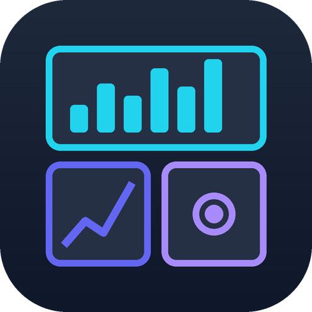
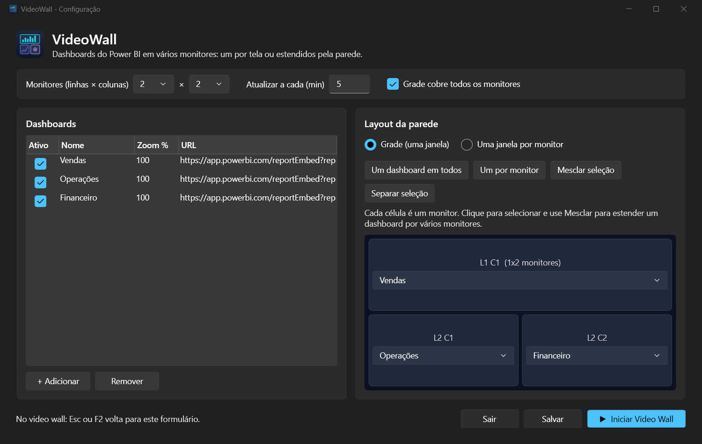

<p align="center">
  
</p>

<h1 align="center">VideoWall</h1>

<p align="center">
  Exiba dashboards do Power BI (ou qualquer página web) em vários monitores:<br/>
  um dashboard por tela ou um único dashboard estendido pela parede inteira.
</p>

<p align="center">
  
</p>

## O que faz

- **Grade configurável**: defina quantos monitores a parede tem (linhas × colunas, até 8×8).
- **Mesclar e separar**: um dashboard pode ocupar um monitor, uma linha inteira ou a parede toda.
- **Uma janela por monitor**: detecta os monitores do Windows e abre uma janela em tela cheia em cada um, com o dashboard escolhido. Funciona com resoluções e escalas diferentes.
- **Atualização automática** dos dashboards em intervalo configurável.
- **Zoom por dashboard**, para encaixar o relatório na tela.
- Tudo configurado por um formulário; a configuração fica em `videowallsettings.json`.

## Como usar

1. Baixe o executável na página de [Releases](../../releases) ou gere o seu (veja abaixo).
2. Abra `VideoWall3x2.exe`. O formulário de configuração aparece.
3. Cadastre os dashboards (nome e URL). No Power BI, use o link de **Inserir > Site ou portal**
   (`https://app.powerbi.com/reportEmbed?...&autoAuth=true`).
4. Escolha o layout:
   - **Grade (uma janela)**: monte a grade, selecione células e use *Mesclar seleção* para estender um dashboard.
   - **Uma janela por monitor**: escolha um dashboard para cada monitor detectado.
5. Clique em **▶ Iniciar Video Wall**.

No video wall, **Esc** ou **F2** volta para o formulário.

Para abrir direto no video wall (por exemplo, ao ligar o PC), use o argumento `/start`:

```
VideoWall3x2.exe /start
```

Coloque um atalho com esse argumento na pasta `shell:startup` para iniciar junto com o Windows.

> O login do Power BI é feito uma vez por PC e fica salvo na pasta `VideoWall3x2.exe.WebView2`, ao lado do executável.

## Requisitos

- Windows 10 ou 11 (64 bits)
- [Microsoft Edge WebView2 Runtime](https://developer.microsoft.com/microsoft-edge/webview2/) (já incluso no Windows 11)

## Compilar

Requer o [.NET 10 SDK](https://dotnet.microsoft.com/download).

```bash
dotnet build VideoWall3x2/VideoWall3x2.csproj
```

Gerar executável único (não precisa de .NET instalado no PC de destino):

```bash
dotnet publish VideoWall3x2/VideoWall3x2.csproj -p:PublishProfile=FolderProfile
```

O resultado fica em `VideoWall3x2/bin/Release/net10.0-windows/publish/`.

### Configuração

`videowallsettings.example.json` é o modelo versionado. Crie `VideoWall3x2/videowallsettings.json`
com suas URLs (ele é ignorado pelo git); sem ele, o build usa o exemplo.

## Tecnologias

WPF (.NET 10) com tema Fluent, [WebView2](https://learn.microsoft.com/microsoft-edge/webview2/) e Win32 para detectar e posicionar janelas nos monitores.

## Licença

[MIT](LICENSE)
